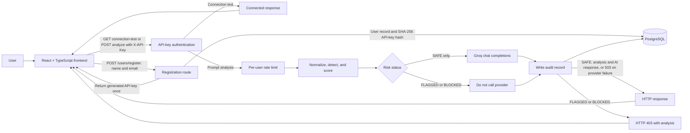

# AI Prompt Firewall

[](https://www.python.org/)
[](https://fastapi.tiangolo.com/)
[](https://react.dev/)
[](https://www.typescriptlang.org/)
[](https://www.postgresql.org/)

A local-first prompt inspection application with a React dashboard and a FastAPI API. The backend checks prompts against keyword and regular-expression rules, assigns a risk score, records analysis in PostgreSQL, and requests a Groq response only for prompts classified `SAFE`.

> Detection is rule-based and intended as a project and learning tool. It is not a guarantee that every malicious prompt will be detected.

## Contents

- [Overview](#overview)
- [Features](#features)
- [Architecture](#architecture)
- [Technology stack](#technology-stack)
- [Screenshots](#screenshots)
- [Prerequisites](#prerequisites)
- [Local setup (Windows PowerShell)](#local-setup-windows-powershell)
- [Accounts and API-key login](#accounts-and-api-key-login)
- [API reference](#api-reference)
- [Risk decisions and AI behavior](#risk-decisions-and-ai-behavior)
- [Audit logging](#audit-logging)
- [Environment variables](#environment-variables)
- [Tests and quality checks](#tests-and-quality-checks)
- [Security considerations](#security-considerations)
- [Roadmap](#roadmap)
- [Contributing](#contributing)

## Overview

An AI prompt firewall inspects a prompt before allowing it to reach an AI provider. This project provides a small end-to-end implementation:

1. A user registers with a name and email and receives a generated API key.
2. The frontend authenticates API requests with `X-API-Key`.
3. The backend normalizes the prompt for detection, runs keyword and regex checks, calculates a risk score, and selects a status.
4. Only a `SAFE` prompt is sent to Groq for response generation. `FLAGGED` and `BLOCKED` prompts do not reach the provider.
5. The backend stores the prompt and decision in PostgreSQL audit logs.

The frontend includes an Overview dashboard, Prompt Playground, Audit Logs, and API Settings. Its account flow uses the same API key as the backend; this version does **not** use email/password authentication.

## Features

- **API-key accounts:** Registration returns a generated API key. The database stores its SHA-256 hash rather than the plaintext key.
- **Prompt inspection:** Unicode/HTML normalization followed by keyword and regular-expression threat checks.
- **Risk scoring:** Distinct finding categories contribute to a score and a `SAFE`, `FLAGGED`, or `BLOCKED` classification.
- **SAFE-only AI response:** SAFE prompts can receive a response from the configurable Groq chat-completions model.
- **Separated AI instructions:** The service sends its system instruction separately from the user prompt and tells the model to treat user content as untrusted.
- **Per-user audit logs:** Stores raw and normalized prompt text, risk status, findings/block reason, optional AI response, and timestamp.
- **Dashboard:** Displays metrics and recent activity based on the latest fetched audit records (up to 100).
- **Prompt Playground:** Submits prompts to the real analysis endpoint and displays analysis, blocked results, and errors.
- **API Settings:** Configures the backend URL and tests backend/API-key connectivity without invoking Groq.
- **Request throttling:** Prompt analysis is limited to 15 requests per user per rolling 60-second window in the current process.

## Architecture



For SAFE requests, the original submitted prompt is sent to Groq after inspection. The normalized form is used for detection and stored separately for audit.

## Technology stack

| Area | Technologies |
|---|---|
| Frontend | React, TypeScript, Vite, `lucide-react` |
| Backend | Python, FastAPI, Uvicorn, Pydantic Settings |
| Persistence | PostgreSQL, SQLAlchemy, Psycopg |
| AI provider | Groq Chat Completions API via `httpx` |
| Tests | Python `unittest`; PostgreSQL-backed integration tests |

## Screenshots

Replace these placeholders with screenshots captured from the running application.

### Overview dashboard

_Screenshot placeholder._

### Prompt Playground

_Screenshot placeholder._

### Audit Logs and API Settings

_Screenshot placeholder._

## Prerequisites

- Git
- Python with `venv` and `pip`
- Node.js and npm
- A running PostgreSQL server and the PostgreSQL command-line tools (`createdb`, `psql`)
- A Groq API key for SAFE prompt response generation

The backend reads configuration from `backend/.env`. The application database schema is provided in `database/schema.sql`; the backend does not create the application tables automatically.

## Local setup (Windows PowerShell)

### 1. Clone the repository

```powershell
git clone https://github.com/vphackers/ai-prompt-firewall.git
Set-Location .\ai-prompt-firewall
```

### 2. Create the PostgreSQL databases and application tables

The application database name is set in `backend/.env`. The integration tests use a separate database named `ai_prompt_firewall_test`.

```powershell
createdb -U postgres prompt_firewall_db
createdb -U postgres ai_prompt_firewall_test
psql -U postgres -d prompt_firewall_db -f .\database\schema.sql
```

If PostgreSQL uses a different administrative role, replace `postgres` with that role. Configure the backend database user to have access to both databases; never point the test suite at a production database.

### 3. Configure and run the backend

```powershell
Set-Location .\backend
py -m venv .venv
.\.venv\Scripts\Activate.ps1
python -m pip install --upgrade pip
python -m pip install -r requirements.txt
Copy-Item .env.example .env
notepad .env
```

Set the database values and Groq settings in `backend/.env` (see [Environment variables](#environment-variables)). Keep this file private and out of Git.

Start FastAPI from the `backend` directory:

```powershell
uvicorn app.main:app --reload
```

The API is configured for the local Vite origins `http://localhost:5173` and `http://127.0.0.1:5173`.

### 4. Install and run the frontend

In a second PowerShell window, from the repository root:

```powershell
Set-Location .\frontend
npm install
npm run dev
```

Open the Vite URL printed in the terminal. The frontend defaults to `http://127.0.0.1:8000` as its backend URL.

## Accounts and API-key login

- **Create account:** The frontend sends a name and email to `POST /users/register`. The backend generates a random API key, stores its SHA-256 hash, and returns the plaintext key once. The UI displays the key after registration so it can be saved.
- **Sign in:** There is no password login endpoint. Sign in with the API key by calling `GET /api/v1/prompt/connection-test` with `X-API-Key`. This verifies connectivity and authentication without prompt analysis or a Groq request.
- **Session:** The frontend keeps the API key in React state and `sessionStorage` for the current browser tab. It revalidates the saved key when restoring a session and clears it on logout. `sessionStorage` is accessible to same-origin JavaScript and is not a substitute for an HttpOnly server-managed session.
- **Logout:** The frontend clears its tab session and returns to the login screen.

There are no password fields, password hashes, JWTs, refresh tokens, email verification, or password-recovery flows in this version.

## API reference

All paths below are relative to the backend origin, normally `http://127.0.0.1:8000`. `X-API-Key` is required where noted.

| Method | Path | Authentication | Description |
|---|---|---|---|
| `GET` | `/` | None | Basic API-running status. |
| `GET` | `/health` | None | Health response. |
| `GET` | `/database-test` | None | Tests the database connection and returns the current database name. |
| `POST` | `/users/register` | None | Creates a user from `name` and `email`; returns the generated API key once. Duplicate email returns `409`. |
| `GET` | `/users/` | None | Returns the user list. |
| `GET` | `/users/{user_id}` | None | Returns a user by ID. |
| `PUT` | `/users/{user_id}` | None | Updates a user's `name` and `email`. |
| `DELETE` | `/users/{user_id}` | None | Deletes a user when no audit records prevent deletion. |
| `GET` | `/api/v1/prompt/connection-test` | `X-API-Key` | Confirms backend connectivity and API-key authentication; does not call Groq. |
| `POST` | `/api/v1/prompt/analyze` | `X-API-Key` | Inspects a prompt, records the decision, and generates a Groq response only for SAFE prompts. |
| `GET` | `/api/v1/prompt/audit-logs` | `X-API-Key` | Returns the authenticated user's audit records with optional filtering and pagination. |

The user list, user-by-ID, user update/delete, and database-test routes do not currently require API-key authentication. Do not expose them on an untrusted network without adding appropriate access controls.

### Registration request

```powershell
curl.exe -X POST "http://127.0.0.1:8000/users/register" `
  -H "Content-Type: application/json" `
  --data-raw '{"name":"Example User","email":"user@example.com"}'
```

The response includes the newly generated `api_key`. Treat it as a secret; it cannot be retrieved from the database in plaintext later.

### Connection test

Replace the placeholder locally with the key returned by registration:

```powershell
$ApiKey = "<API_KEY_FROM_REGISTRATION>"
curl.exe -X GET "http://127.0.0.1:8000/api/v1/prompt/connection-test" `
  -H "X-API-Key: $ApiKey"
```

### Prompt analysis

```powershell
$ApiKey = "<API_KEY_FROM_REGISTRATION>"
curl.exe -X POST "http://127.0.0.1:8000/api/v1/prompt/analyze" `
  -H "Content-Type: application/json" `
  -H "X-API-Key: $ApiKey" `
  --data-raw '{"prompt":"Explain prompt injection at a high level."}'
```

The request schema requires a non-whitespace `prompt` with a maximum length of 10,000 characters.
Successful SAFE responses include `is_suspicious`, `total_findings`, `findings`, `risk_score`, `risk_status`, `detected_categories`, and `ai_response`. Non-SAFE decisions return HTTP `403` with analysis details in the response's `detail`; a Groq failure on a SAFE prompt returns HTTP `503` after attempting to persist the audit record.

### Audit logs

```powershell
$ApiKey = "<API_KEY_FROM_REGISTRATION>"
curl.exe -G "http://127.0.0.1:8000/api/v1/prompt/audit-logs" `
  -H "X-API-Key: $ApiKey" `
  --data-urlencode "skip=0" `
  --data-urlencode "limit=50" `
  --data-urlencode "risk_status=BLOCKED"
```

`skip` defaults to `0`; `limit` defaults to `50` and must be between `1` and `100`. `risk_status` accepts `SAFE`, `FLAGGED`, or `BLOCKED`.

## Risk decisions and AI behavior

The inspection pipeline normalizes text for detection using Unicode NFKC normalization, HTML entity decoding, zero-width character removal, lowercasing, and whitespace normalization. It then combines keyword and regex findings.

Current keyword categories include `PROMPT_INJECTION` and `SYSTEM_PROMPT_EXTRACTION`. Current regex categories include `XSS` and `SQL_INJECTION`. This is a finite ruleset, not a general-purpose semantic classifier.

The risk engine counts each distinct category once, caps the total score at 100, and applies these thresholds:

| Risk score | Status | Analysis endpoint behavior |
|---:|---|---|
| Less than 20 | `SAFE` | Calls Groq and returns analysis plus `ai_response` with HTTP `200` when the provider succeeds. |
| 20–49 | `FLAGGED` | Does not call Groq; records the decision and returns HTTP `403` with analysis details. |
| 50 or more | `BLOCKED` | Does not call Groq; records the decision and returns HTTP `403` with analysis details. |

Current category weights are 40 for prompt injection, 45 for system-prompt extraction, and 50 each for XSS and SQL injection. Unknown categories score 10. Multiple findings in the same category do not increase that category's score more than once.

Prompt analysis is limited to 15 requests per user per rolling 60-second window in a process-local in-memory limiter. A SAFE request that passes inspection but encounters a Groq failure is audited and returns HTTP `503`; provider credentials and raw provider error bodies are not returned to the frontend.

The Groq request uses the configured model, `temperature=0.3`, a maximum of 512 completion tokens, and an `httpx` timeout of 20 seconds (5 seconds to connect).

## Audit logging

The `prompt_audit_logs` table stores:

- The original prompt (`raw_prompt`) and normalized detection text (`sanitized_prompt`)
- Risk status and serialized findings/block reason
- The AI response when one was generated
- User ID and creation timestamp

Audit retrieval is scoped to the authenticated user and returns newest records first. The dashboard fetches up to 100 records; its totals and block rate are based on that fetched subset, not an all-time database count. Raw prompts are retained in PostgreSQL, so configure retention and access controls appropriate to the data you process.

## Environment variables

`backend/app/config.py` loads `backend/.env`. `backend/.env.example` contains placeholders only.

| Variable | Required | Default / example | Purpose |
|---|---|---|---|
| `DB_HOST` | Yes | `localhost` in the example | PostgreSQL host. |
| `DB_PORT` | No | `5432` | PostgreSQL port. |
| `DB_NAME` | Yes | Set to `prompt_firewall_db` for the setup above | Application database name. |
| `DB_USER` | Yes | Your PostgreSQL role | Database username. |
| `DB_PASSWORD` | Yes | Your PostgreSQL password | Database password. |
| `GROQ_API_KEY` | Needed for SAFE responses | `your_groq_api_key` in the example | Backend-only Groq credential. |
| `GROQ_MODEL` | No | `openai/gpt-oss-120b` | Groq chat-completions model ID. |

Do not put provider keys in frontend environment variables. `.env` is ignored by the repository's `.gitignore`; commit only the placeholder `.env.example`.

## Tests and quality checks

Run the backend tests from `backend`:

```powershell
Set-Location .\backend
.\.venv\Scripts\Activate.ps1
python -m unittest discover -s test
```

The suite includes unit tests for authentication, schemas, normalization, detection, risk scoring, rate limiting, audit services, and mocked Groq HTTP behavior. It also includes PostgreSQL integration tests that connect to the separate `ai_prompt_firewall_test` database. The test configuration checks the database name before operating; create that test database before running the full suite.

Frontend checks are run from `frontend`:

```powershell
Set-Location .\frontend
npm run build
npm run lint
```

The frontend package does not currently define a test script.

## Security considerations

- Keep API keys private. The backend stores a SHA-256 hash, but the generated plaintext key is returned once and must be protected by the client.
- The frontend stores the API key in `sessionStorage` for the current tab. JavaScript running on the same origin can access it; an XSS issue could expose it. Logout clears the stored key, but this does not protect against a compromised browser context.
- API-key authentication is a simple per-account credential. There is no password login, JWT, refresh-token flow, expiration, or dedicated key-rotation endpoint.
- Several user-management and database diagnostic routes are unauthenticated as currently implemented; protect or remove them before public deployment.
- The rate limiter is process-local and resets on restart. It is not shared across multiple workers or instances.
- CORS currently allows only the two local Vite origins. Configure an explicit production allowlist before hosting the frontend elsewhere.
- Raw prompts and AI responses may be persisted in audit records. Avoid submitting sensitive data unless the database's access and retention policies are appropriate.
- Keep `backend/.env` out of source control and use backend-only environment configuration for Groq.
- Use HTTPS, restricted database access, least-privilege database credentials, and production-grade secret management when deploying. The current local development setup is not a production deployment configuration.

## Roadmap

The following items are **planned; they are not implemented in the current version**:

- Password-based authentication with a carefully designed password-hashing and recovery flow, or a server-managed session/JWT design
- Access controls for user-management and diagnostic routes
- Shared/distributed rate limiting and configurable quotas
- Broader prompt-injection coverage, evaluation datasets, and detector benchmarking
- Production deployment configuration, environment-specific CORS, and operational monitoring
- Audit-log retention controls and administrative workflows

## Contributing

Contributions and issue reports are welcome. Before opening a pull request:

1. Keep changes focused and describe their security impact where relevant.
2. Add or update tests for behavior changes.
3. Run the backend unittest suite and frontend build/lint checks.
4. Never include `.env` files, API keys, database credentials, or real sensitive prompt data in commits or test fixtures.
